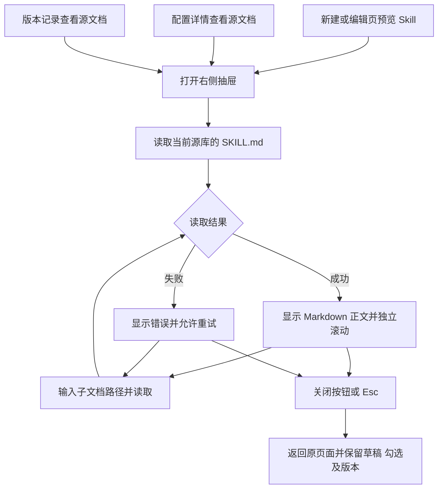

# Agent Skill 列表与预览抽屉交付说明

日期：2026-10-10。用户审核修改清单后回复“开始”，由主代理单独完成。

## 交付结果

Agent 新建与编辑页的 Skill 列表采用两列排布：左侧显示勾选框、名称和描述，右侧对齐预览按钮。长描述在自身区域换行，700px 以下改为上下排列。配置详情及版本记录里的 Skill 链接支持换行。

新建／编辑、配置详情、版本记录的预览入口共用右侧抽屉。桌面宽度为 800px，窗口不足 800px 时使用全宽。标题、关闭按钮和文档路径位于上方，正文独立滚动。点击关闭按钮或按 Esc 返回原页面，保留草稿、勾选项、当前版本和所在分区，键盘焦点回到预览入口。

抽屉仍读取当前 Skill 源库，并明确显示“当前源文档”。已发布 Agent 的固定资源快照与指纹沿用原有规则。文档路径支持回车或按钮读取；读取失败显示接口提示，再次读取可恢复。开始读取另一文档时清除上一份正文，避免路径与正文不一致。每次重新打开预览从 `SKILL.md` 开始。

## 文件范围

| 文件 | 内容 |
| --- | --- |
| `ai-data/apps/web/src/features/agents/components/agent-form.vue` | Skill 行布局及预览按钮可访问名称 |
| `ai-data/apps/web/src/features/agents/pages/agents-page.vue` | 三类入口共用 Element Plus 抽屉、关闭状态及详情链接排布 |
| `ai-data/apps/web/src/features/agents/components/skill-preview.vue` | 文档路径表单、读取状态和独立正文区域 |
| `ai-data/apps/web/src/styles/management.css` | Agent Skill 专用列表、抽屉及窄屏样式 |
| `任务交接/AgentSkill抽屉验收/` | 浏览器记录及七张页面截图 |
| `任务交接/README.md` | 追加交付入口 |

沿用已安装的 Vue、Element Plus 和 Markdown 组件，依赖操作与子代理数量均为 0。业务源码改动限定为以上四个 Web 文件。

## 执行流程



## 验证结果

使用 Web 最新生产构建、临时本机认证服务、隔离管理接口夹具及项目现有 Skill 文档进行 Chromium 检查。管理数据写请求为 0，页面运行错误为 0；临时服务及浏览器已关闭。

| 检查 | 结果 |
| --- | --- |
| Web 应用与 Node 配置类型检查 | 通过 |
| 本次三个 Vue 文件 ESLint、四个源码文件 Prettier | 通过 |
| Web Vite 生产构建 | 通过 |
| 现有管理基础测试 | 4 个文件、7 项通过 |
| 抽屉专项浏览器检查 | 9 组通过，详见 [浏览器验收记录](AgentSkill抽屉验收/浏览器验收.json) |
| 现有管理布局浏览器回归 | 4 项通过，1 项旧测试定位失败，说明如下 |

专项覆盖中英文长描述对齐、800px 右侧抽屉、正文滚动与固定标题、关闭后焦点和表单状态、子文档读取及失败重试、亮暗主题、390px／1024px 适配、配置详情、历史版本和派生编辑草稿。

现有 `management-layout.spec.ts` 的数据源用例仍查找按钮 `visits visits 可查询`。失败时页面实际显示“对象白名单列表”表格、“选择 visits”复选框及“配置 visits”按钮；对应白名单组件与测试均为本轮开始前的既有实现。本轮记录此项失败，未调整数据源模块或该测试。

首次沙箱内类型检查无法正确解析 pnpm 依赖链接，浏览器依赖读取也出现 `EPERM`；授权在沙箱外使用原有依赖后，类型与构建通过。专项检查初次测量落在抽屉入场动画中，随后等待抽屉位置稳定；正文滚动使用较短窗口检查，最终九组检查全部通过。

本轮使用已有 CLI，主要命令在 `ai-data/apps/web` 执行：

```powershell
node node_modules/vue-tsc/bin/vue-tsc.js -p tsconfig.app.json
node node_modules/typescript/bin/tsc -p tsconfig.node.json
node node_modules/vite/bin/vite.js build
node node_modules/vitest/vitest.mjs run tests/shared/management
$env:WEB_E2E_PREVIEW = '1'
node node_modules/@playwright/test/cli.js test tests/e2e/management-layout.spec.ts --workers=1
```

## 截图与生效方式

- [Skill 列表，暗色桌面](AgentSkill抽屉验收/01-Skill列表-暗色.png)
- [Skill 抽屉，暗色桌面](AgentSkill抽屉验收/02-Skill抽屉-暗色.png)
- [Skill 抽屉，亮色桌面](AgentSkill抽屉验收/03-Skill抽屉-亮色.png)
- [Skill 列表，手机](AgentSkill抽屉验收/04-Skill列表-手机.png)
- [Skill 抽屉，手机](AgentSkill抽屉验收/05-Skill抽屉-手机.png)
- [配置详情入口](AgentSkill抽屉验收/06-配置详情预览.png)
- [版本记录入口](AgentSkill抽屉验收/07-版本记录预览.png)

Web 开发服务刷新页面即可查看。`ai-data/apps/web/dist` 已更新；静态部署使用该构建产物，本轮未重新封装 `release`。API、DAS 及正式数据库无需因本次 UI 调整变更。
