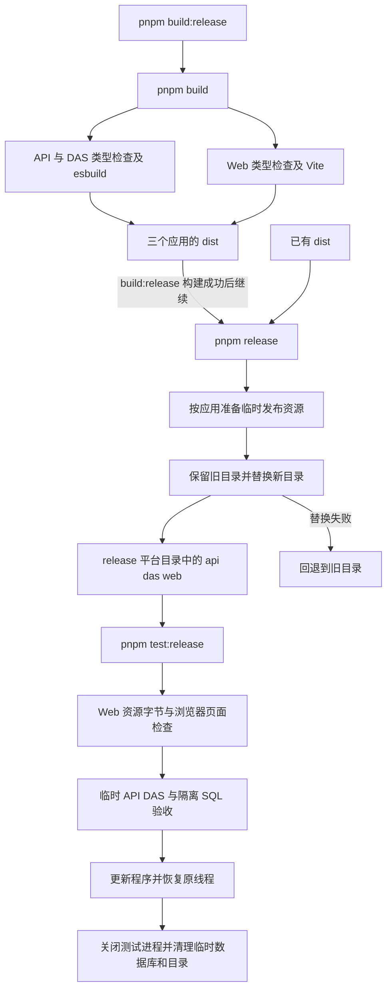

# 三部分构建与发布交付说明

日期：2026-10-10。用户确认 API、DAS、Web 统一构建与封包，并要求核对 `test:release`。本轮由主代理单独实施，依赖安装、升级与卸载均为 0。

## 1. 命令职责

执行目录：`D:/porject_new_2026/ai-data/ai-data`。

| 命令                 | 行为                           | 输出                                          |
| -------------------- | ------------------------------ | --------------------------------------------- |
| `pnpm build`         | 检查类型并构建三个应用         | 各应用的 `dist`                               |
| `pnpm release`       | 读取现有构建并复制完整发布资源 | `release/<platform>-<arch>/api`、`das`、`web` |
| `pnpm build:release` | 构建成功后继续封包             | 三个发布目录                                  |
| `pnpm test:release`  | 验收现有发布目录               | Web 检查结果与 API/DAS 集成测试结果           |

Web 发布目录直接包含 `index.html`、`assets/`、`fonts/` 等构建资源，可作为静态站点根目录。三个应用原始 `dist` 均保留。单项整理仍可用 `pnpm release api`、`pnpm release das` 或 `pnpm release web`。

本机已生成 `release/win32-x64/api`、`release/win32-x64/das` 和 `release/win32-x64/web`。其他平台沿用既有目标平台依赖要求，本轮实机验收为 Windows x64。

## 2. 文件范围

| 文件                                                        | 主要变更                                                             |
| ----------------------------------------------------------- | -------------------------------------------------------------------- |
| `ai-data/package.json`                                      | 新增 `build:release`，先构建后封包                                   |
| `ai-data/apps/api/package.json`                             | 构建命令专注生成 API bundle                                          |
| `ai-data/apps/data-access/package.json`                     | 构建命令专注生成 DAS bundle                                          |
| `ai-data/scripts/prepare-release.mjs`                       | 默认整理三部分，完整复制 Web 资源，保留旧发布目录并支持失败回退      |
| `ai-data/scripts/tests/prepare-release.test.mjs`            | 三部分输出、资源复制、重复封包、缺失入口、失败回退及原有发布边界测试 |
| `ai-data/scripts/test-release.mjs`                          | 检查三部分入口，依次执行 Web 与后端验收                              |
| `ai-data/scripts/test-web-release.mjs`                      | 新增 Web 发布资源与 Chromium 基础页面验收                            |
| `ai-data/apps/api/tests/integration/release.integration.ts` | 模型夹具响应能力探测，按当前工具协议读取 Schema 后提交 JSON 参数     |
| `任务交接/BUILD.md`、`任务交接/README.md`、本文件           | 更新构建交接入口、交付与验证记录                                     |

## 3. 执行流程

目录替换按单个应用执行。复制或校验失败时保留该应用原目录；替换重命名失败时尝试恢复旧目录。若恢复本身失败，错误会报告保留旧目录的位置。Windows 的 `EPERM`、`EACCES`、`EBUSY` 最多重试 10 次，每次间隔 100ms。

## 4. 发布验收范围

Web 使用现有 Vite 与 Playwright，从发布目录提供仅本机可访问的静态服务，逐个核对 HTTP 资源字节，并用 Chromium 检查登录页、未登录访问报表路由及页面刷新。认证恢复使用固定 401 响应；这部分验收范围为静态资源与基础页面加载。

API/DAS 继续使用真实发布进程、SQL Server 和官方 app-server，覆盖空库初始化、登录、DAS 注册、授权 SQL 查询、Skill 子文档、工具 Schema 读取、查询证据、更新时配置和密钥保留、重启后恢复同一官方线程。模型响应由本机确定性夹具提供。

运行需要当前平台发布产物、已安装的 Chromium，以及具备创建和删除随机测试库权限的 SQL Server 连接。默认读取 API 本地 SQL 配置，支持 `SQLSERVER_TEST_CONFIG`。测试库使用 `ai_data_release_test_` 随机前缀，测试结束执行清理。正式应用服务未手动重启。

## 5. 验证记录

- `pnpm build` 通过，执行前后发布目录文件的路径、长度和修改时间一致。
- `pnpm release` 通过，执行前后三部分原始构建文件的路径、长度和修改时间一致。
- `pnpm build:release` 实际执行通过，顺序完成构建和三个发布目录整理。
- 工程测试原 44 项通过；追加替换失败回退场景后，发布专项 13 项通过，共 45 个工程场景分批通过。
- `pnpm test:release` 通过：Web 202 个资源及 3 项页面检查，API/DAS 发布集成 1 项完整链路通过。
- contracts 242 项、metadata 28 项、API 765 项通过。
- DAS 完整测试首次 483 项通过、1 项 HTTP 超时用例失败；该文件 5 项单独复验全部通过，相关业务代码及测试未调整。
- Web 完整普通测试 227 项通过；普通测试及工程场景合计 1,791 项分批通过。
- 根类型检查与全仓 lint 通过；更新后 API 类型检查、本次代码 lint/格式及 `git diff --check` 通过。

首次工程测试受到沙箱临时目录与链接限制，授权执行后确认新增 Web 场景因功能尚未实现而失败，随后完成实现并通过。首次实际封包遇到 Windows DAS 目录重命名 `EPERM`，已补充保留旧目录、失败回退与有限重试，并完成实际封包复验。

原发布集成夹具在能力探测时解析空请求体，且查询参数仍使用旧对象形态，导致运行没有查询证据。已按当前协议修正夹具，保留原 SQL 结果、证据、状态哈希和同线程恢复断言，最终完整验收通过。

全仓格式检查最初报告 20 个文件，其中本轮修改的发布集成文件已格式化并通过检查；其他 19 个既有问题保留。Vite 仍提示部分静态分块大于 500kB。锁文件保持原状，运行使用已安装 Node 24.19.0 与 pnpm 12.4.1，验证时关闭包管理器自动版本安装。
