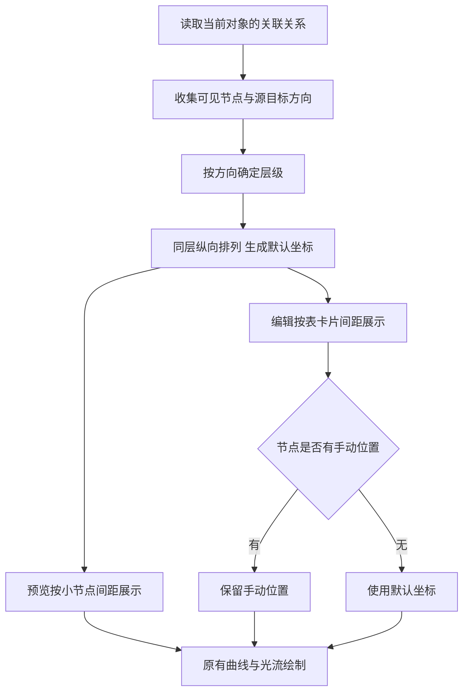

# 业务关系左右布局交付说明

日期：2026-10-10。用户批准统一业务关系预览与编辑画布的左右排布，由主代理实施。

## 交付效果

默认布局按关联方向排列：源表在左、目标表在右。打开当前表只决定展示哪些关系，同一条关系从不同端点进入时保持相同左右顺序。

- `cv_report → cv_process_record`：从任一端进入，均为报告表在左、闭环记录表在右。
- `cv_report` 同时关联 `cv_process_record` 和 `cv_report_main`：两个目标位于右侧同一列，纵向分开。
- 单条关系保留上下略微错开的曲线效果；多级关联逐层向右，同层对象按稳定顺序排列。
- 编辑时优先使用用户手动拖动的位置。现有曲线、表级连接点、光流及其开关继续使用原实现。

## 原因与改动

原预览按数组下标交替摆在左右两边，编辑画布则把当前打开的表固定放左。这两套坐标规则与关系的源、目标方向无关，因此出现目标在左、源在右，曲线在端点处折返的问题。

新增 `layoutRelations`，由预览和编辑共同使用。函数先根据当前可见对象建立方向图，按入向关系确定层级，再生成各列坐标；预览和编辑分别采用适合自身卡片大小的间距。多条相同端点关系只参与一次节点层级计算。未关联对象沿添加顺序占用空列，已有环形关系按稳定顺序保留回边。

编辑画布把正在配置的连线纳入布局，已编辑关系的预览替代原边参与计算。节点的最终坐标优先使用已有手动位置，其次使用默认布局。

## 文件范围

- 新增 `ai-data/apps/web/src/features/data-management/stores/relation-layout.ts`。
- 修改 `ai-data/apps/web/src/features/data-management/components/relations-graph.vue`。
- 修改 `ai-data/apps/web/src/features/data-management/components/relation-canvas.vue`。
- 新增 `ai-data/apps/web/tests/features/data-management/relation-layout.test.ts`。
- 新增 `ai-data/apps/web/tests/e2e/relation-layout.spec.ts`。
- 新增本交付说明和四张浏览器截图，在任务交接 README 追加入口。

依赖安装、数据库迁移与业务关系数据修改均为 0。

## 执行流程

## 验证

浏览器回归先在旧实现中复现两个错误：报告表预览中的目标表位于左侧；从闭环记录表进入时，编辑画布中的报告源表位于右侧。实现后两个场景通过。

- 关系布局与已有关系草稿单元测试：2 个文件、11 项通过。覆盖端点进入顺序、多个目标、多级关系、重复端点、预览/编辑间距比例、未关联对象及已有环形关系。
- 浏览器回归：7 项通过，包含新建与发布、多字段编辑、发布冲突、表级拖线、拖线到空白处选表、光流开关、亮暗与窄屏、入向关系编辑，以及本次新增的两个布局场景。
- 新增浏览器断言检查源节点右边界位于目标节点左边界之前，曲线采样横坐标持续向右；打开并关闭关联设置后，手动拖动坐标保持不变。
- Web 应用与 Node 配置类型检查、本次 ESLint、格式检查及 Vite 生产构建通过。构建保留现有大分包体积提示。

首次并行运行单元测试时发生 Vitest 工作线程启动超时，单独重跑后 11 项全部通过。浏览器使用隔离内存数据，按反馈中的表标识与关系结构复现；四张截图均已目视核对。

## 浏览器截图

| 进入对象            | 预览                                                                  | 编辑                                                                      |
| ------------------- | --------------------------------------------------------------------- | ------------------------------------------------------------------------- |
| `cv_report`         | [两个目标均在右侧](关系布局方向验收/table.dbo.cv_report-预览.png)     | [同列上下排列](关系布局方向验收/table.dbo.cv_report-编辑.png)             |
| `cv_process_record` | [报告源表在左](关系布局方向验收/table.dbo.cv_process_record-预览.png) | [保持相同左右顺序](关系布局方向验收/table.dbo.cv_process_record-编辑.png) |
