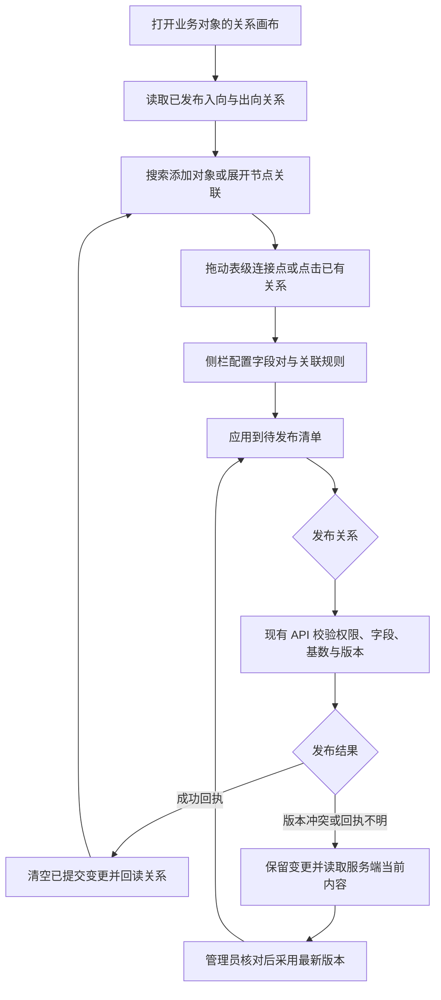
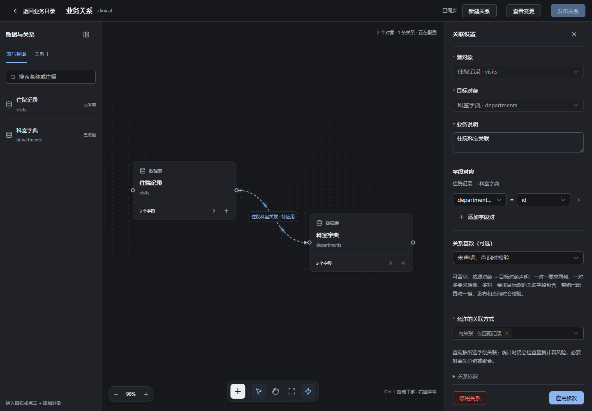
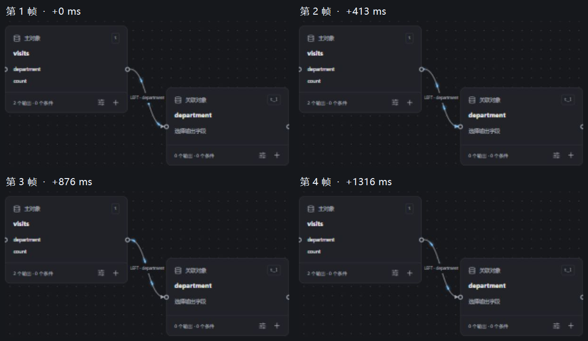
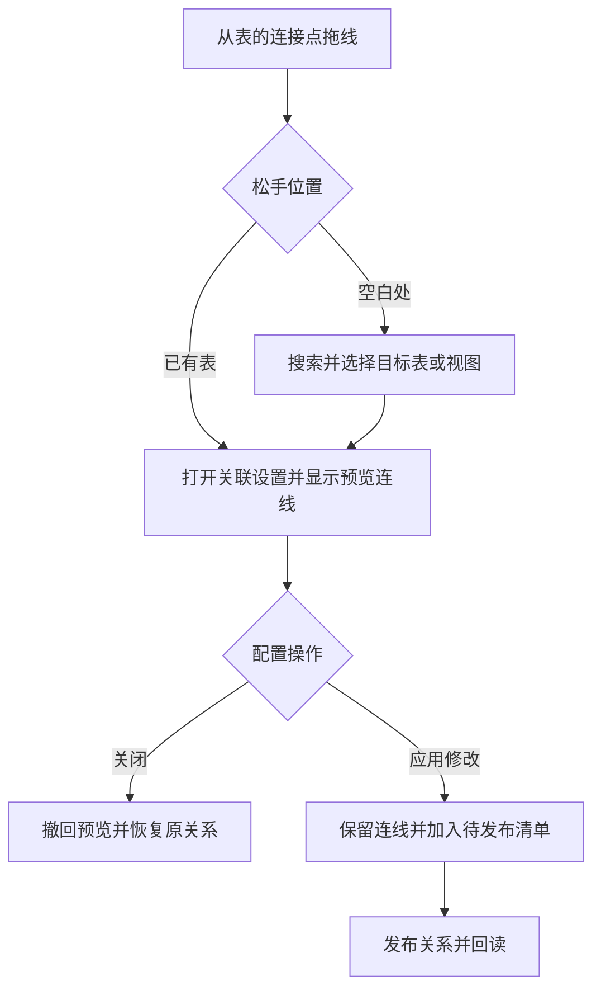
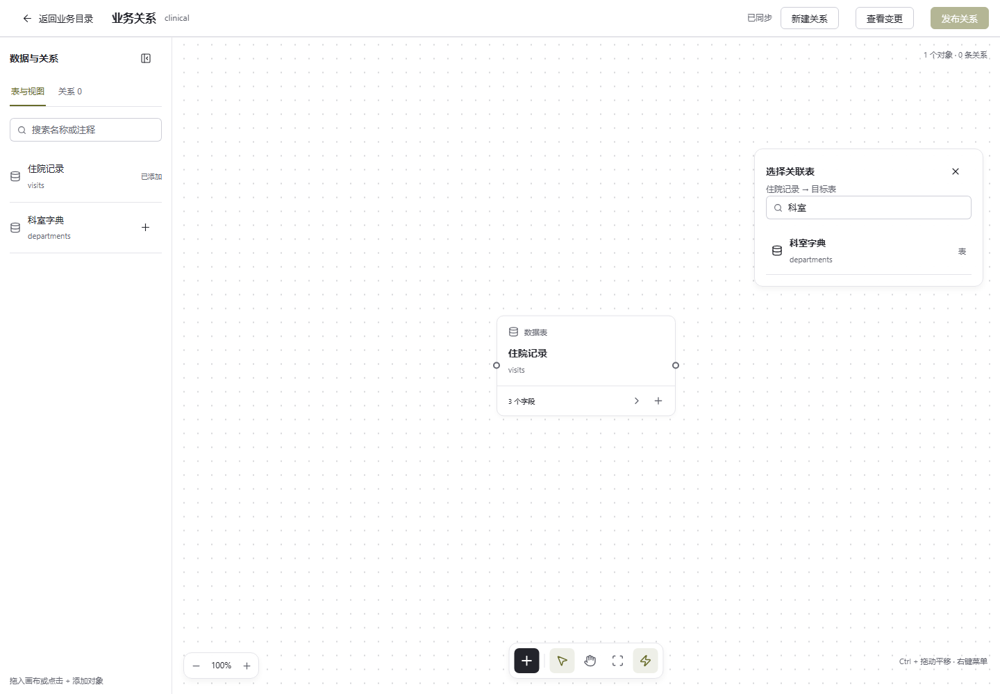
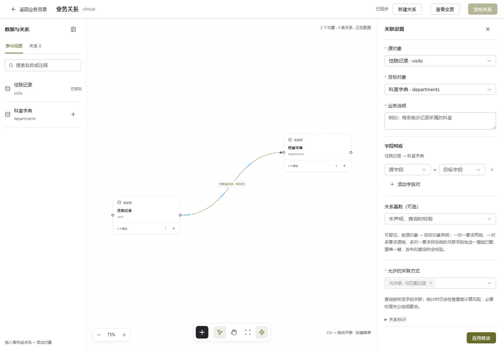
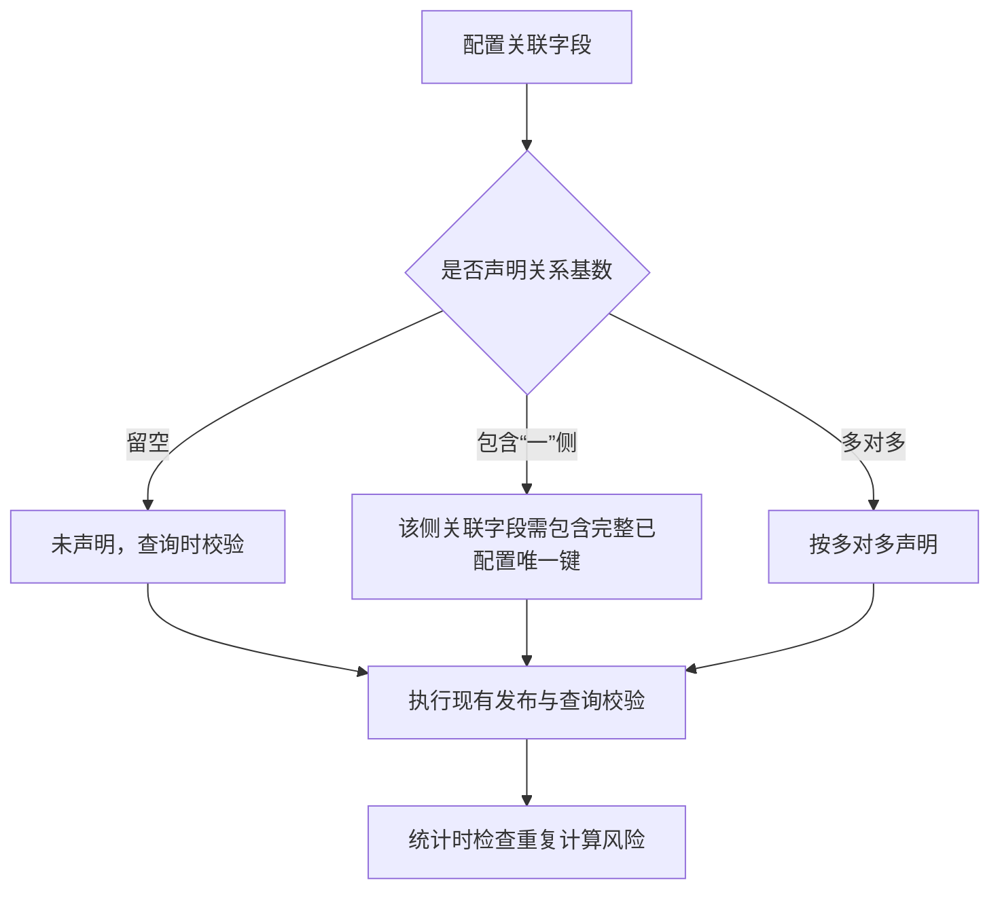
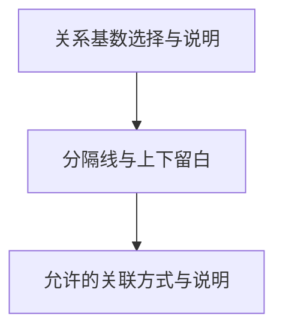

# 关系画布与快捷键交付说明

日期：2026-10-09。

## 交付范围

用户批准在现有画布风格上改善业务关系编辑、补齐报表画布快捷操作，并要求连线光流可开关。实施前已将当时完整工作区保存为 Git 提交 `99a36d2`（`chore: 保存画布调整前的完整工作区`）。本次由主代理单独实施，依赖操作和数据库迁移均为 0。

业务入口为：**数据管理 → 业务目录与关系 → 选择数据源和对象 → 业务关系与关联图 → 编辑关系画布**。

## 使用与生效

- 画布沿用报表的点阵背景、对象卡片、浮动工具栏和连线样式。卡片展示表名、标识和字段总数，左右各一个连接点。左侧搜索表与视图，点击或拖入画布；从源表右侧连接点拖向目标表左侧，打开关联配置。
- 点击连线，在右侧配置业务说明、多组字段对应、关系基数和允许的关联方式。源对象和关系标识在已发布关系中固定；入向关系按其原始方向编辑。
- 点击“应用修改”将编辑内容加入待发布清单。同一条关系多次应用合并为一项。新建、修改和停用统一点击“发布关系”后持久化并回读。
- 关系清单可以搜索与定位连线，节点可以展开一层关联。画布逐步加载所需对象，连线表达源表到目标表的方向；具体字段对统一在关联配置中搜索和选择。
- 画布布局在本次编辑中保留；离开有待发布修改时提示确认。关系规则以发布后的服务端内容为准。
- Web dev 刷新即可加载；静态部署需使用本轮 Web 构建。API、DAS 的关系接口及权限校验沿用现有实现。

### 两处编辑画布共用的交互

| 操作                           | 行为                                             |
| ------------------------------ | ------------------------------------------------ |
| 左键拖动节点                   | 调整节点位置                                     |
| Ctrl＋左键拖动                 | 平移画布，节点位置保持原值                       |
| 工具栏“平移模式”               | 左键拖动平移画布                                 |
| 右键空白处                     | 添加查询／对象、适应视图、切换平移模式和连线动效 |
| 右键节点                       | 配置查询／新建出向关系、添加或展开关联、聚焦节点 |
| 右键连线或连线标签             | 编辑关联规则、查看或聚焦两端对象                 |
| 菜单方向键、Home、End          | 在可用菜单项之间移动                             |
| Esc 或点击菜单外               | 关闭菜单                                         |
| 工具栏闪电按钮／菜单“连线动效” | 开关沿曲线行进的光流，静态线及方向箭头保留       |

右键菜单根据点击位置展示对应操作，靠近屏幕边缘时自动调整位置。文本输入仍使用浏览器文本菜单。光流采用浅灰底线、三束蓝色亮光、渐细渐隐尾部与柔光，沿实际曲线从源对象向目标对象循环。光流开关在报表画布、关系编辑画布和关系预览间共享，并保存到当前浏览器 `ai-data.canvas-motion` 偏好。

## 修改文件

以下路径均相对于 `ai-data/apps/web/`：

| 文件                                                                                              | 职责                                             |
| ------------------------------------------------------------------------------------------------- | ------------------------------------------------ |
| `src/features/data-management/components/relation-manager.vue`                                    | 画布入口、草稿、批量发布、版本冲突核对与离开确认 |
| `src/features/data-management/components/relation-canvas.vue`（新增）                             | 关系节点、表级连线、展开、缩放和平移             |
| `src/features/data-management/components/relation-node.vue`（新增）                               | 对象卡片、字段总数和表级连接点                   |
| `src/features/data-management/components/relation-inspector.vue`（新增）                          | 关联规则可视化编辑                               |
| `src/features/data-management/components/relations-graph.vue`                                     | 关系预览使用统一光流偏好                         |
| `src/features/data-management/stores/relation-draft.ts`、`relation-draft-types.ts`（新增）        | 合并一层关系、暂存变更、核对最新版本             |
| `src/shared/canvas/use-canvas-navigation.ts`、`use-canvas-motion.ts`（新增）                      | Ctrl 平移、光流偏好                              |
| `src/shared/canvas/use-canvas-menu.ts`、`canvas-context-menu.vue`、`canvas-menu-types.ts`（新增） | 上下文识别、菜单定位与键盘操作                   |
| `src/features/reports/components/report-canvas.vue`                                               | 报表画布快捷键、右键菜单、光流开关               |
| `src/features/reports/components/flowing-edge.vue`                                                | 共用光流渲染、平行关系偏移和可操作标签           |
| `src/styles/relation-canvas.css`（新增）、`src/styles/report-editor.css`                          | 画布及侧栏布局、亮暗主题和窄屏适配               |
| `tests/features/data-management/relation-draft.test.ts`（新增）                                   | 关系方向、合并、停用和冲突恢复                   |
| `tests/e2e/relation-canvas.spec.ts`（新增）                                                       | 建立及编辑关系、发布、冲突、入向版本与响应式交互 |
| `tests/e2e/report-editor.spec.ts`、`tests/e2e/management.spec.ts`                                 | 快捷键、菜单、光流、已有编辑和关系预览回归       |

交付说明及截图保存在任务交接目录，README 追加入口。

## 执行流程

发布成功后即使回读失败，也不会再次发送已确认的变更。版本冲突或网络回执不明时保留清单并暂停重复发布，核对时移除已生效操作，继续修改才采用最新版本。

## 验证记录

| 验证                              | 结果                                                                                    |
| --------------------------------- | --------------------------------------------------------------------------------------- |
| 工作区类型检查 `pnpm typecheck`   | 全部通过                                                                                |
| 工作区代码规范 `pnpm lint`        | 全部通过，最新光流修改另行复验通过                                                      |
| 工程规则 `pnpm test:engineering`  | 42 项通过                                                                               |
| contracts 普通测试                | 242 项通过                                                                              |
| metadata 普通测试                 | 28 项通过                                                                               |
| API 普通测试                      | 759 项通过                                                                              |
| DAS 普通测试                      | 484 项通过                                                                              |
| Web 普通测试                      | 221 项通过，五个包合计 1,734 项通过                                                     |
| 浏览器交互                        | 18 个场景分批通过；按蓝色光流参考图更新后，相关 4 项再次通过                            |
| 本轮源码格式、`git diff --check`  | 通过                                                                                    |
| Web 完整构建                      | 通过；保留已有大分块提示                                                                |
| API / DAS 编译与 Windows x64 产物 | 编译通过；API 整理成功，DAS 首次遇到 Windows `EPERM` 重命名失败，重试现有整理脚本后成功 |

工作区整体格式检查仍报告 20 个既存文件：API/DAS 配置与会话模块、`catalog-manager.vue`、contracts 健康状态文件及锁文件等。这些文件与实施前快照一致，本轮仅格式化本次改动。

普通测试采用单工作进程 `--pool=forks --maxWorkers=1`，避免本机线程池启动超时。浏览器验证包括 Ctrl 平移与普通节点拖动互不干扰、右键节点和连线菜单、屏幕边缘菜单定位、键盘焦点、光流偏好保存、隐藏页暂停、减少动态效果、51 节点／50 连线和亮暗窄屏布局。

浏览器验收使用隔离登录服务及管理 API 替身，覆盖真实 DOM、对象拖线、右键菜单、键盘焦点、发布请求和回读。没有在用户实际业务库中创建或停用关系；本轮未执行真实数据库发布集成。

### 表级连接点复验

2026-10-09 按用户确认的表级连接方式收紧节点卡片；调整 `relation-node.vue`、`relation-canvas.vue`、`relation-manager.vue`、`relation-canvas.css` 和对应浏览器用例，依赖及关系合同保持原状。拖线只填充源对象和目标对象，关联配置中的字段对由用户选择。已有关系按两端对象展示，发布内容继续保存完整字段对应。

Web 类型检查、完整构建、本轮 lint/格式和 `git diff --check` 通过。4 项关系画布浏览器用例通过，覆盖每张表左右各一个连接点、拖线后选择字段并正确发布、已有多字段及入向关系回读、版本冲突、光流开关和亮暗窄屏。已更新本页截图；验证使用隔离 API 替身，实际业务配置未修改。

## 界面截图

[亮色](关系画布与快捷键验收/关系画布-亮色.png) · [1024 宽度](关系画布与快捷键验收/关系画布-1024.png) · [390 宽度](关系画布与快捷键验收/关系画布-390.png)

[蓝色光流](关系画布与快捷键验收/蓝色光流.png) · [右键菜单](关系画布与快捷键验收/关系画布-右键菜单.png)

## 2026-10-09 光流连续移动修复

用户反馈蓝色亮光一直停在原地。实际浏览器复现后发现：动画状态为运行中，但 `stroke-dashoffset` 仅在 `0px` 和 `calc(33.3333px)` 两个端点之间跳变，两者恰好相差一个光束重复间隔，呈现出的亮光位置相同。此前用例只确认偏移值变化，未检查中间位置，因此没有识别出此问题。

本次统一 `flowing-edge.vue` 中的尾部偏移变量和 `report-editor.css` 动画端点为 `px` 长度，使浏览器连续插值。报表、关系编辑和关系预览沿用同一个光流组件及开关。`report-editor.spec.ts` 增加必须出现中间偏移值的断言，能够识别原来的端点跳变问题。依赖操作为 0。

验证：Web 完整构建及类型检查通过；本次代码 lint、格式检查通过；4 项浏览器回归通过，覆盖连续中间偏移、开关及偏好、减少动态效果、隐藏页面暂停、51 节点／50 条连线和表级关系连接。浏览器使用本地正式构建与隔离 API，实际业务配置未修改。

同一页面连续四帧的采样时间间隔为 0、413、876、1316 毫秒，偏移分别为 8.37106、0.875499、26.9938、19.221 像素。下图由四张实际浏览器截图裁剪拼接，原图及偏移记录保留在同目录中。Web dev 刷新即可加载；静态部署需更新 Web 构建产物。

[第 1 帧原图](关系画布与快捷键验收/光流逐帧/修复后-全图-0.jpg) · [第 2 帧原图](关系画布与快捷键验收/光流逐帧/修复后-全图-1.jpg) · [第 3 帧原图](关系画布与快捷键验收/光流逐帧/修复后-全图-2.jpg) · [第 4 帧原图](关系画布与快捷键验收/光流逐帧/修复后-全图-3.jpg)

## 2026-10-09 拖线选表与配置预览

用户要求业务关系画布像报表一样支持拖线选择表，并指出连接两个对象后只出现关联设置、没有连线。原实现只处理连接完成事件，连线数据仅来自已发布关系和已应用的修改，因此缺少空白处选表及属性编辑期间的预览。

- 从起点拖到空白处，在松手位置打开表/视图选择菜单，可按名称、标识或数据库注释搜索；节点的“新建关系”入口使用同一菜单。
- 选择目标后，新对象按松手位置加入配置预览，并立即显示带光流的“待应用”连线。连接已有对象同样立即显示连线。
- 编辑源对象、目标对象或说明时，预览同步更新。编辑已有关系时用预览替换原线，避免重复显示。
- 关闭未应用的配置时撤回预览；应用修改后转为待发布关系，发布仍走现有校验和版本核对。

新增 `relation-target-picker.vue` 负责搜索选表，`use-relation-connection.ts` 负责拖线事件和菜单位置；修改 `relation-canvas.vue`、`relation-manager.vue`、`relation-draft-types.ts`、`relation-canvas.css` 以及 `relation-canvas.spec.ts`。本轮仅涉及 Web 交互，依赖操作为 0。

验证先补充拖线选表和即时连线断言，旧构建分别因菜单不存在、预览线不存在而失败。实现后 Web 类型检查与完整构建通过，本次 lint/格式及 `git diff --check` 通过；5 项关系画布浏览器场景通过，涵盖拖线搜索与空结果、Esc 关闭、立即显示连线、取消撤回、应用去重、发布回读、入向关系版本、冲突保留、光流开关及亮暗窄屏。浏览器运行本地 Web dev 和隔离 API 替身，实际业务配置未修改。

Web dev 刷新即可加载，静态部署需更新 Web 构建。截图为实际浏览器验收画面：

## 2026-10-09 关系基数与唯一键文案澄清

用户指出原描述容易让人误以为配置关系必须先填写唯一键。本次将关联设置改为“关系基数（可选）”，留空提示改为“未声明，查询时校验”；业务配置改为“唯一键（可选）”，说明每组字段应唯一确定一条原始记录，以及当前需要手动配置、暂不自动读取数据库主键或唯一索引。

关联设置说明按源对象到目标对象的方向声明：一对一要求两侧、一对多要求源侧、多对一要求目标侧的关联字段包含一整组已配置唯一键。关系基数可以留空，查询统计仍会检查重复计算风险，必要时先分组或聚合。

仅修改 Web 的 `relation-inspector.vue` 和 `catalog-form.vue` 文案，沿用现有发布和查询校验。依赖操作为 0。

验证：Web 类型检查与完整构建通过，本次文件 lint、格式及 `git diff --check` 通过；已有关系画布浏览器用例 1 项通过，检查正式构建的亮暗与窄屏显示，并更新截图。浏览器使用隔离 API 替身，实际业务配置未修改。Web dev 刷新即可加载，静态部署需更新 Web 构建。

### 关联设置分区

用户要求将相邻配置分开。在关系基数说明和“允许的关联方式”之间添加主题分隔线，上下各留 20px 间距。仅修改 `relation-inspector.vue` 模板和 `relation-canvas.css` 样式，依赖操作为 0。

验证：本次 lint、格式与 `git diff --check` 通过；已有浏览器用例 1 项通过，使用 Web dev 和隔离 API 检查亮暗及窄屏布局，已核对实际截图。刷新 Web dev 页面即可看到分区。
