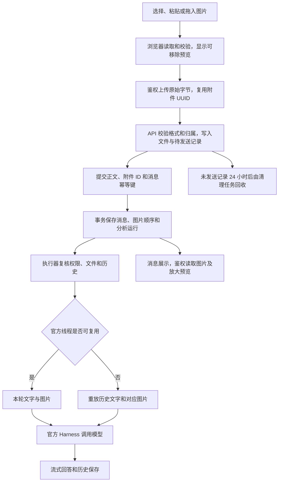

# 图片对话交付说明

日期：2026-10-10。用户批准图片上传、消息关联、模型输入及历史恢复清单，由主代理单独实施。依赖操作 0 次，子代理 0 个。

## 交付状态与启用顺序

图片对话代码已接通，覆盖 Web、API 和共享合同。数据库中配置的 `rj-model-v2` 已通过真实多图识别及官方进程重启后的同线程追问测试。实际模型地址和凭据直接通过现有模型服务读取。

**当前 API 配置指向的既有数据库 `127.0.0.1:1433 / ai_data` 尚未执行附件补丁。** 获准清单约定“验收使用隔离库，实际数据库执行范围另行明确”。本轮 SQL 写入仅发生在随机命名的隔离测试库，验收结束后清理；现有库只读取模型配置。

现有部署启用顺序：

1. 在目标 API 元数据库执行 [附件表补丁](../ai-data/scripts/sql/add-conversation-attachments.sql)，新增下面两张表。此步骤需另行确认目标库执行范围。
2. 将 API 图片目录配置为持久化目录，确保运行账户可读写；相对路径以 API 启动工作目录为准。
3. 部署本轮 API 和 Web 构建并重启 API。新 API 启动时会访问附件表，必须先完成补丁。
4. 登录分析工作台，选择绑定支持图片模型的 Agent，添加图片后发送。

本轮已生成 API、DAS、Web 的 `dist`；`release` 仍是此前封包，部署新代码时执行 `pnpm release` 或 `pnpm build:release`。实际服务未由本轮手动重启。

## 使用行为与限制

| 项目     | 当前行为                                                                         |
| -------- | -------------------------------------------------------------------------------- |
| 输入     | JPG、PNG、WebP；图文、纯图、多图；选择、粘贴、拖入                               |
| 每条容量 | 最多 4 张；单张 10 MiB；合计 20 MiB                                              |
| 尺寸     | 单边最多 8192 像素，总像素最多 2000 万                                           |
| 格式检查 | 浏览器解码；API 校验真实格式签名、结构、尺寸及容量，拒绝动画 PNG/WebP            |
| 发送     | 读取完图片后允许发送，全部上传成功后提交消息                                     |
| 重试     | 上传复用附件 UUID；消息回执不确定时复用原正文、附件顺序及幂等键                  |
| 历史     | 图片元信息随消息返回，登录鉴权读取原图，支持放大预览和刷新恢复                   |
| 草稿     | 当前身份内存中按会话保留；账号退出时释放文件预览资源；未发送草稿不跨页面刷新保存 |
| 恢复     | 复用线程只附本轮图片；重建线程按消息和图片顺序重放历史图片                       |
| 恢复容量 | 一次模型输入最多重放 20 张、20 MiB；超过时明确提示新建会话                       |

模型仍按已有 Agent 固定配置版本选择；`rj-model-v2` 是本轮验收使用的模型，不硬编码到业务运行配置。

## 数据表和持久化

| 表                                     | 用途                                                                     |
| -------------------------------------- | ------------------------------------------------------------------------ |
| `dbo.conversation_attachments`         | 附件 UUID、会话、名称、格式、字节数、尺寸、SHA-256、状态、创建和过期时间 |
| `dbo.conversation_message_attachments` | 消息、附件及顺序；一个附件绑定一条消息                                   |

原 `conversation_messages` 文字字段继续使用。消息、附件绑定和分析运行通过同一事务提交；绑定失败时整笔回滚。纯文字沿用原幂等哈希，图片消息的哈希包含正文、附件及顺序。

完整首建补入 [001_initial_api_schema.sql](../ai-data/apps/api/migrations/001_initial_api_schema.sql)。现有 `001` 已执行的库不会因修改该文件自动增表，需要运行单独补丁。补丁使用与首建相同的应用锁和事务，并以表是否存在判断；隔离测试验证连续执行两次成功、旧消息数保持一致。

API 配置根字段可设置 `attachments_directory`；省略时使用 `secrets/conversation-attachments`。文件名由服务端校验的附件 UUID 推导，用户文件名仅存作展示元信息。目录不作为静态资源公开，读取时检查用户、组织、会话、状态、文件类型、长度和 SHA-256。

未发送附件 24 小时过期，启动及每小时清理；每轮最多清理 100 条已删除记录，并处理超过 24 小时且无数据库记录的临时或孤立文件。已发送文件随现有会话软删除策略保留，会话删除后不可读取。

部署时持久保存数据库、图片目录和官方运行时状态目录；构建及封包不包含用户图片。HTTP 图片响应使用 `private, no-store`，Web 通过现有认证和刷新逻辑读取 Blob，不把令牌放入图片 URL。

## 接口与调用职责

下表为 API 服务路径，Web 同源代理前缀为 `/api`。

| 方法与路径                                                  | 调用内容和结果                                                                             |
| ----------------------------------------------------------- | ------------------------------------------------------------------------------------------ |
| `PUT /conversations/:conversation/attachments/:id?name=...` | 已登录 Web 以原始图片字节上传，Content-Type 为对应图片类型；ID 为稳定 UUID；返回公开元信息 |
| `GET /attachments/:id`                                      | 鉴权并返回原始图片字节                                                                     |
| `DELETE /attachments/:id`                                   | 移除当前用户尚未发送的附件，返回 204                                                       |
| `POST /conversations/:id/messages`                          | 原合同新增可选 `attachment_ids`，正文与图片至少一项非空；返回消息和分析运行                |
| `GET /conversations/:id`                                    | 原历史接口的图片消息新增可选 `attachments` 元信息列表                                      |

公开元信息字段为 `attachment_id`、`name`、`mime_type`、`size_bytes`、`width`、`height`。API 与 Web 共用合同和限制。附件路由的二进制解析仅作用于其插件范围，认证先于请求正文读取。

运行执行器在调用模型前复核全部历史图片的归属和文件可读性。官方 Harness 接收带消息顺序标记的 `localImage` 输入，经官方运行时转换为 Responses 图片项。图片缺失、内容改变、超限和上游拒绝均沿现有运行失败通路返回。

## 执行流程图



## 文件清单

以下路径相对 `ai-data/` 工作区。

| 范围            | 新增                                                                                                                                                                                                                                                                  | 修改                                                                                                                                                                                                                  |
| --------------- | --------------------------------------------------------------------------------------------------------------------------------------------------------------------------------------------------------------------------------------------------------------------- | --------------------------------------------------------------------------------------------------------------------------------------------------------------------------------------------------------------------- |
| 合同            | `packages/contracts/src/analysis-runs/image-attachment.ts`、`image-attachment-types.ts`                                                                                                                                                                               | 同目录 `analysis-run.ts`，`packages/contracts/src/index.ts`                                                                                                                                                           |
| 数据库          | `scripts/sql/add-conversation-attachments.sql`                                                                                                                                                                                                                        | `apps/api/migrations/001_initial_api_schema.sql`                                                                                                                                                                      |
| 附件服务        | `apps/api/src/conversations/attachment-record.ts`、`attachment-types.ts`、`image-validation.ts`、`attachment-service.ts`、`sql-attachment-repository.ts`                                                                                                              | 同目录 `conversation-service.ts`、`conversation-types.ts`、`sql-conversation-repository.ts`                                                                                                                           |
| API 接口与装配  | `apps/api/src/routes/attachment-routes.ts`                                                                                                                                                                                                                            | `routes/conversation-routes.ts`、`app.ts`、`app-types.ts`、`index.ts`、`config/api-config.ts`                                                                                                                         |
| 运行与模型      | —                                                                                                                                                                                                                                                                     | `apps/api/src/runtime/analysis-executor.ts`、`create-analysis-runtime.ts`、`runtime-types.ts`、`sql-runtime-repository.ts`，`harness/codex-analysis-harness.ts`、`harness-types.ts`                                   |
| Web             | `apps/web/src/features/analysis/components/draft-images.vue`、`message-images.vue`                                                                                                                                                                                    | 同模块 `api/analysis-schema.ts`、`stores/analysis-workspace.ts`、`analysis-workspace-types.ts`、`pages/analysis-page.vue`；`apps/web/src/shared/http/http-types.ts`、`transport.ts`；`main.ts`、`styles/analysis.css` |
| API 测试        | `tests/conversations/image-validation.test.ts`、`tests/routes/attachment-routes.test.ts`、`tests/harness/image-protocol.test.ts`、`tests/integration/attachments.integration.ts`、`image-model.integration.ts`、`tests/support/test-image.ts`、`web-image-fixture.ts` | `tests/runtime/analysis-executor.test.ts`、`tests/support/api-fixtures.ts`、`web-analysis-fixture.ts`                                                                                                                 |
| 合同与 Web 测试 | `packages/contracts/tests/analysis/image-attachments.test.ts`、`apps/web/tests/features/analysis/image-drafts.test.ts`、`tests/e2e/analysis-images.spec.ts`                                                                                                           | —                                                                                                                                                                                                                     |

另新增本交付说明、两张验收截图，并在任务交接 README 追加本轮记录。现有其他功能改动保留。

## 验证记录

开发按业务场景先补测试，已确认图片协议、合同、校验、SQL 绑定和 Web 草稿在实现前的预期失败；完成实现后通过。追加的图片读取竞争测试先复现发送漏图，再用读取状态约束发送及页面代次修复。

| 验证             | 结果与边界                                                                                                                                        |
| ---------------- | ------------------------------------------------------------------------------------------------------------------------------------------------- |
| API 普通测试     | 772 项通过，含官方进程图片协议和执行器图片恢复                                                                                                    |
| 合同测试         | 245 项通过，覆盖纯图、图文、重复 ID、数量、未知字段、元信息格式与容量                                                                             |
| Web 普通测试     | 229 项通过，含图片读取期间禁止发送和切换会话丢弃迟到预览的回归                                                                                    |
| 元数据库测试     | 28 项通过                                                                                                                                         |
| 工程规则         | 45 项通过                                                                                                                                         |
| DAS 普通测试     | 全量 484 项中 483 项通过、原有 HTTP 50ms socket 超时断言失败；所在测试文件 5 项单独复验通过，保留全量时序失败记录                                 |
| SQL 集成         | 28 项通过：6 项附件测试、22 项既有分析测试；只用隔离库                                                                                            |
| 真实模型         | `rj-model-v2` 识别两张红/绿测试图；关闭并重建官方进程，恢复同一线程回答图片数量和第二张颜色，通过                                                 |
| 浏览器           | 3 项图片流程及 2 项原有流式回归通过；最终生产构建的 3 项图片流程再次通过；覆盖 JPG/PNG/WebP、纯图、多图、粘贴、拖入、预览、回执丢失重试与手机布局 |
| 类型、lint、构建 | 根目录类型、lint、三部分构建通过；最终 Web 修复后的类型、lint 和生产构建再次通过，构建保留既有大 chunk 提示                                       |
| 格式             | 本轮代码已格式化；全仓检查仍有 18 个既有文件格式问题                                                                                              |

浏览器使用隔离认证服务和内存附件夹具，SQL 存储由真实隔离数据库集成验证，模型能力由独立官方 Harness 实测；没有把浏览器夹具的示例回答计为真实模型结果。

复验入口（从 `ai-data/` 工作区执行；沿用已有依赖）：

```powershell
pnpm --filter @ai-data/contracts test
pnpm --filter @ai-data/api test
pnpm --filter @ai-data/web test
pnpm --filter @ai-data/api exec vitest run --config vitest.integration.config.ts tests/integration/attachments.integration.ts tests/integration/analysis.integration.ts
$env:IMAGE_MODEL_TEST = '1'
$env:IMAGE_MODEL_NAME = 'rj-model-v2'
pnpm --filter @ai-data/api exec vitest run --config vitest.integration.config.ts tests/integration/image-model.integration.ts
Remove-Item Env:IMAGE_MODEL_TEST, Env:IMAGE_MODEL_NAME
pnpm --filter @ai-data/web exec playwright test tests/e2e/analysis-images.spec.ts tests/e2e/analysis-stream.spec.ts
pnpm typecheck
pnpm lint
pnpm build
```

真实模型入口从当前 API 配置读取数据库连接，查找已启用模型，并通过已有加密机制解析模型凭据。SQL 集成需要创建、删除随机测试库的权限。测试代码会清理自身库、临时目录及进程。

桌面历史：[图片历史](图片对话验收/图片历史.png)。手机输入：[390 像素输入](图片对话验收/图片输入-390.png)。截图为隔离夹具界面，已核对图片尺寸、放大关闭和手机无横向溢出。
