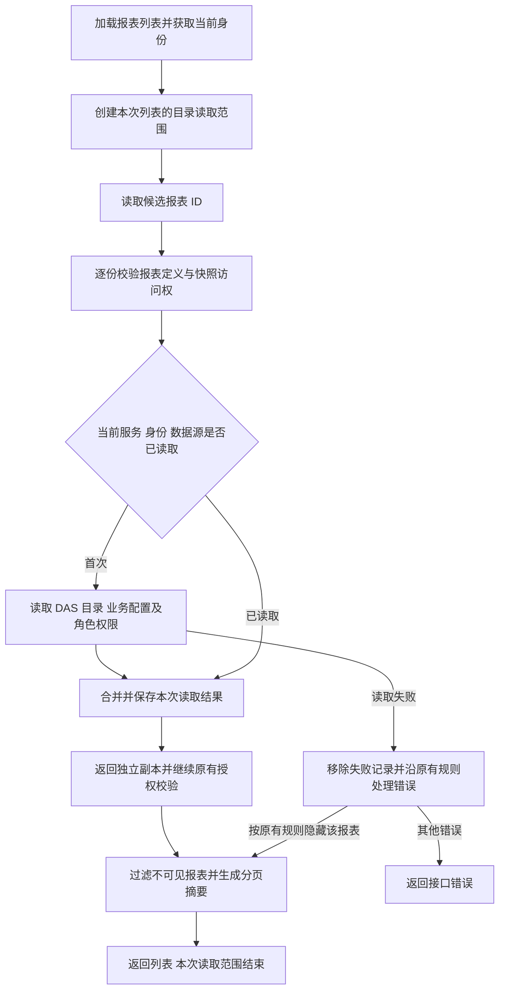

# 报表列表目录复用交付说明

日期：2026-10-09。用户批准修复报表中心打开后卡片列表等待过久的问题，由主代理实施。

## 结果

当前开发 API 已使用修复后的代码。加载相同的 2 张卡片，Web dev 代理请求从 22.904 秒降至 1.652 秒，响应均为 HTTP 200、545 字节。

| 验证入口                           |    修复前 |   修复后 | 验证结果                 |
| ---------------------------------- | --------: | -------: | ------------------------ |
| 实际 API 直连列表                  | 27.001 秒 | 3.100 秒 | 2 张卡片、545 字节       |
| 实际 Web dev 代理列表              | 22.904 秒 | 1.652 秒 | 2 张卡片、545 字节       |
| 正式服务代码与真实数据的同进程对照 | 26.569 秒 | 1.376 秒 | 完整列表序列化内容一致   |
| 对照过程中的 DAS 目录发现          |     17 次 |     1 次 | 同一身份、同一数据源复用 |
| 对照过程中的 API 元数据 SELECT     |    119 次 |    23 次 | 保留每份报表的授权流程   |

以上为本机、当前 2 张报表的实测。HTTP 与服务剖析分别执行，时间受数据库和网络状态影响；服务剖析中的嵌套计时不可累加。实际 HTTP 测量涵盖返回列表所需的后端与代理时间，未计入浏览器绘制。

## 原因与实现

卡片列表复用报表定义和历史快照的正式读取逻辑，以维持现有可见性规则。定义校验、关联授权和展示字段校验都会读取目录；其中按对象读取的实现每次都重新获取整个数据源的目录，导致两个报表重复发现目录 17 次。

现在 `ReportManagementService.list` 为本次列表创建独立的异步读取范围，`BusinessCatalogService.listAuthorized` 在该范围内复用第一次目录读取的 Promise。身份、数据源相同的并发读取和后续读取共用一次结果。

复用按目录服务实例、数据源和完整 `AuthContext` 区分。实例维度隔离不同仓储及事务；身份维度包含用户、组织、会话、角色与授权上下文。返回目录使用独立副本，读取失败会移除对应记录。下一次请求重新读取目录及权限。

定义、快照、对象、字段、行范围和查询校验继续按已有流程执行。目录复用仅由报表列表入口开启，其他操作维持即时读取行为。分页、响应合同、数据库结构和依赖保持现状。

## 执行流程

## 文件范围

- 新增 `ai-data/apps/api/src/catalog/catalog-read-scope.ts`：列表内目录复用与隔离。
- 修改 `ai-data/apps/api/src/catalog/business-catalog-service.ts`：目录读取接入复用范围。
- 修改 `ai-data/apps/api/src/reports/report-management-service.ts`：在列表入口创建读取范围。
- 修改 `ai-data/apps/api/tests/reports/report-management-service.test.ts`：增加性能和权限回归场景。
- 新增本交付说明及修复后的测量记录，在任务交接 README 追加入口。

## 验证

新增 6 项回归先在旧实现上失败，失败原因均为目录读取次数超过预期；修复后通过。覆盖同请求并发合并、逐报表授权、后续请求权限撤销、并发请求和身份隔离、数据源及服务实例隔离、失败后重新读取，以及目录返回值修改隔离。

- 报表、目录、查询测试：23 个文件、288 项通过。
- API 全量普通测试：97 个文件、765 项通过。
- API TypeScript 检查、构建入口类型检查、本次 ESLint 和格式检查通过。
- API 入口 esbuild 构建通过，验证产物位于忽略目录 `apps/api/secrets/report-list-performance/api-build-check.mjs`。
- 真实 API 和 Web dev 代理请求均成功；独立进程使用正式服务类、实际元数据库和已验证在线的 DAS，对照确认列表完整内容一致。

测量使用正常登录的临时会话，完成后均注销。剖析仅执行元数据 SELECT 和目录读取，禁止业务查询及写入事务。依赖操作与数据库迁移为 0。

原始记录：

- [修复前 HTTP 记录](报表列表耗时实测/http-baseline.json)
- [修复后 HTTP 记录](报表列表耗时实测/http-after.json)
- [修复后的同进程对照记录](报表列表耗时实测/service-profile-after.json)
- [前期诊断说明](报表列表耗时实测/实测说明.md)
