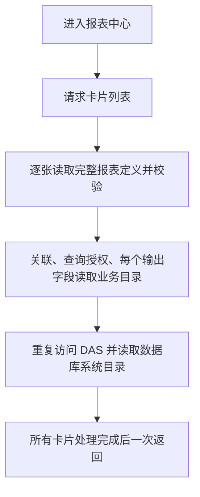

# 报表中心卡片列表耗时实测

2026-10-09 用户要求自行测试。使用项目配置中的账号走正式登录，测试正在运行的 API 3101 和 Web dev 5173，再在独立进程中复用正式服务代码、真实元数据库及在线 DAS 拆分耗时。测试会话均已注销。

## 实际接口

| 请求 | HTTP 状态 | 返回卡片 | 响应大小 | 首个响应头 | 完整响应 |
| --- | --- | --- | --- | --- | --- |
| API `/reports?limit=20` | 200 | 2 | 545 字节 | 27,000 ms | 27,001 ms |
| Web dev `/api/reports?limit=20` | 200 | 2 | 545 字节 | 22,903 ms | 22,904 ms |

以上是正常认证后的 HTTP 请求计时，未测浏览器绘制；几乎全部耗时发生在后端返回响应头之前。原始结果见 [http-baseline.json](http-baseline.json)。

## 服务链路剖析与对照

| 场景 | 总耗时 | 卡片 | 同一数据源目录读取 | 本地 API 元数据 SQL |
| --- | --- | --- | --- | --- |
| 原逻辑 | 24,023.8 ms | 2 | 17 次 | 119 次 |
| 测试进程内复用本次请求的授权目录 | 1,621.8 ms | 2 | 1 次 | 23 次 |

17 次目录读取均针对“危急值系统数据源”，累计 23,840.1 ms，平均 1,402.4 ms，单次范围 1,158.5–2,117.0 ms。报表定义读取与校验累计 23,953.6 ms，其中展示字段校验累计 14,394.3 ms。两次快照读取尝试累计仅 20.8 ms。

这些分类含嵌套调用和并行 SQL，不能直接相加。元数据 SQL 计数来自测试进程，不含 DAS 内部查询和在线 API 的认证查询。

对照仅在独立测试进程里，对同一身份和数据源的 `listAuthorized` 结果进行单次请求内复用；所有原有校验路径仍被调用。两个场景的列表响应经稳定序列化比较完全一致。该次对照约降低 93.2% 耗时，不能视为正式修复后的性能保证；正式实现仍需验证权限变化、并发及错误恢复。

在线 DAS 集合先通过实际 API 的认证与注册会话检查获取；独立进程继续核对数据库中的健康心跳，使用现有签名服务访问该集合。原始事件、调用次数和耗时见 [service-profile.json](service-profile.json)。

## 原因与处理方向

主要重复发生在 `ReportManagementService.list/summary`、`ReportDefinitionService.read`、`ReportQueryService.validatePresentation` 和 `BusinessCatalogService.getAuthorized/listAuthorized`。DAS 的 `CatalogService.listBySourceId` 每次调用连接器 `discoverCatalog`，再与白名单求交集。

优先方向是消除同一请求内的重复目录和权限数据读取，同时保持当前卡片可见性规则；后续可评估批量读取摘要。当前仅完成诊断及对照实验，运行服务和业务源码均未修改。

## 测试边界

- 元数据剖析执行器只接受 `SELECT`，业务查询执行依赖设置为立即报错，未执行报表业务查询或写入业务配置。
- 使用正常登录产生的临时测试会话，结束后已注销；凭据、令牌和业务结果行均未写入输出。
- 未启动第二套 API、未迁移数据库、未安装依赖、未重启当前服务。
- 诊断脚本保存在 Git 忽略的 `ai-data/apps/api/secrets/report-list-performance/`；需复测时在 `ai-data/apps/api` 运行 `node --import tsx secrets/report-list-performance/http-probe.ts` 或 `node --import tsx secrets/report-list-performance/profile-probe.ts`。
