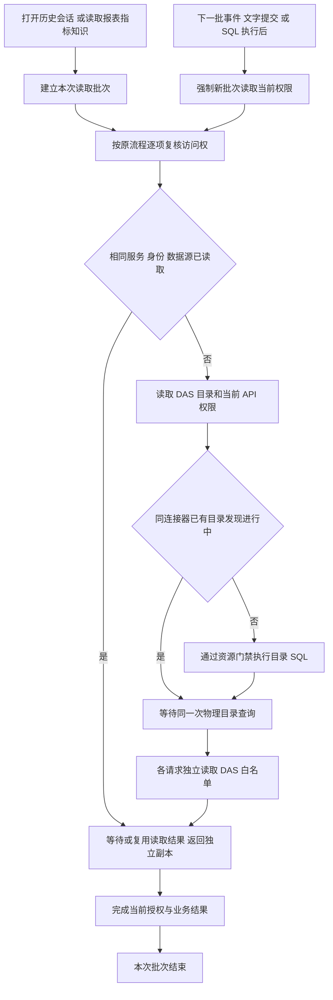

# 目录读取复用交付说明

日期：2026-10-10。用户在重新打开历史会话时遇到 DAS `QUERY_LIMIT_EXCEEDED`，要求排查同类入口，并以“都对接上”批准接入。主代理单独实施，依赖操作为 0。

## 结果与原因

会话恢复、事件回放、分析上下文、查询授权、报表、指标、知识、偏好和角色权限预览已接入目录读取批次。关系画布等并发请求在 DAS 共用同一连接器正在进行的物理目录发现。

原错误发生在 `QueryResourceGate.run` 的等待队列容量检查。恢复历史会话会逐轮复核证据，每份证据的查询授权又按主表、关联对象和配置重复读取完整目录；并发证据复核会同时进入 DAS 资源门禁。此次修复合并这些重复读取，资源限制继续生效。

以下为使用正式服务类及可计数外部替身的回归结果，数据来自测试夹具：

| 场景                                         |         修复前目录读取 |              修复后目录读取 |
| -------------------------------------------- | ---------------------: | --------------------------: |
| 一次查询授权                                 |                      2 |                           1 |
| 两个查询、两个展示字段的报表构建             |                      8 |                           1 |
| 两个指标的范围及维度校验                     |                     10 |                           1 |
| 两轮历史会话，每轮 12 份证据                 |                     48 |                           1 |
| 20 份同时到达的 DAS 目录发现，数据源并发为 1 | 部分请求被资源门禁拒绝 | 1 次驱动查询，20 份请求成功 |

以上次数来自回归夹具。后续已使用正式服务和临时 DAS HTTP 端点读取截图中的实际会话，实际证据数量、真实模型计数及物理目录对照见[调试实测说明](目录读取复用实测/实测说明.md)。该测量不包含浏览器渲染时间。

## 批次与权限边界

`withCatalogReadScope` 在顶层建立批次，嵌套服务沿用当前批次。缓存键继续包含目录服务实例、完整授权上下文和数据源；失败读取清除对应记录，返回值逐次复制。

`withFreshCatalogReadScope` 用于每批 SSE 事件、每次公开文字提交、模型恢复准备、最终交付，以及 SQL 查询后的证据复核。报表执行的准备阶段和执行后的提交阶段分别建立批次。长时间运行的模型、查询和 SSE 连接不会共用一个永久授权快照。

记忆工厂复用主数据库已有的目录服务；事务目录服务按 executor 保持稳定，同一事务内可复用，不同事务隔离。保存知识、偏好、报表定义和完成报表的事务校验已接入同一批次。

DAS 只合并当前连接器尚未结束的物理目录查询。查询成功或失败后释放 Promise，下一次发现重新读取。每份目录请求仍独立读取白名单并做逻辑对象映射。不同连接器的请求分别处理。

每次新操作仍会读取当前目录与权限。因此重新打开会话依然可能产生目录请求，同一批次中的多份历史证据共用读取结果。

## 执行流程

## 文件范围

下列生产文件位于 `ai-data/apps/api/src/`：

| 文件                                     | 本次改动                                           |
| ---------------------------------------- | -------------------------------------------------- |
| `catalog/catalog-read-scope.ts`          | 嵌套复用及显式新批次                               |
| `query/query-authorization-service.ts`   | 单次查询授权内的对象和配置读取复用                 |
| `analysis-runs/analysis-run-service.ts`  | 运行、证据、步骤批次；事件和查询完成后的新批次     |
| `conversations/conversation-service.ts`  | 恢复多轮会话共用批次                               |
| `runtime/analysis-executor.ts`           | 恢复准备、每次文字和最终交付的批次                 |
| `runtime/analysis-tools.ts`              | 目录、指标、知识、偏好、报表发现工具及指标规则预检 |
| `reports/report-query-service.ts`        | 查询构建、字段校验和快照转定义                     |
| `reports/report-definition-service.ts`   | 读取、版本、列表、模板和写事务校验                 |
| `reports/report-service.ts`              | 快照中多份证据复核                                 |
| `reports/report-management-service.ts`   | 版本、产物、报表及会话导出                         |
| `reports/report-execution-service.ts`    | 执行准备、执行后复核和结果读取                     |
| `reports/report-template-service.ts`     | 已发布模板集合校验                                 |
| `reports/report-revision-service.ts`     | 暂存和完成编辑时的事务校验                         |
| `reports/create-report-services.ts`      | 保存快照定义和完成运行时的报表批次                 |
| `metrics/metric-service.ts`              | 指标列表、维度校验及执行准备                       |
| `knowledge/knowledge-service.ts`         | 候选、来源、正式版本、管理列表及写事务校验         |
| `preferences/preference-service.ts`      | 偏好、待确认集合及写事务校验                       |
| `memory/memory-access.ts`                | 范围、偏好字段及来源证据复核                       |
| `memory/memory-runtime.ts`               | 记忆快照、知识指纹和适用规则                       |
| `memory/create-memory-services.ts`       | 主库和事务目录服务实例复用                         |
| `catalog-admin/catalog-admin-service.ts` | 角色查询权限预览                                   |
| `index.ts`                               | 向记忆工厂传入主目录服务                           |

另外修改：

- `ai-data/apps/data-access/src/connectors/database-connector.ts`：合并在途目录发现。
- `ai-data/apps/api/tests/integration/report-flow.integration.ts`：同步记忆工厂装配参数。
- 新增 `ai-data/apps/api/tests/catalog/catalog-read-scope.test.ts`：9 项批次、读取次数和权限边界回归。
- 新增 `ai-data/apps/data-access/tests/connectors/catalog-discovery-concurrency.test.ts`：3 项并发合并、失败重试、返回副本和白名单回归。
- 本交付说明，以及 `任务交接/README.md` 的追加入口。

本轮沿用工作区已有变更，未提交 Git。数据库迁移、依赖操作、子代理均为 0。API 和 DAS 的 `dist/index.js` 已更新；实际服务未手动重启，`release` 未重新封包。

## 验证

先运行新增复现测试：API 五个场景均因读取次数过多失败，DAS 并发场景出现拒绝；接入后通过。随后追加执行中撤权、流式输出分批复核、工具调用及事务工厂隔离场景。

验证使用已经安装的 `.bin` 工具：

- API 普通测试覆盖最终 781 项，分批通过。首次全量 777 项中的 10 项受沙箱本机网络、子进程或目录链接限制影响；对应 10 个文件共 42 项在沙箱外通过。最后对全部修改业务模块复验 41 个文件、247 项通过，包含追加的 4 项测试。
- DAS 普通测试覆盖最终 487 项，分批通过。首次全量 486 项中 18 项受本机 HTTP 限制影响；对应 3 个文件共 29 项沙箱外通过，最终新增目录文件 3 项通过。
- 工程规则 45 项通过；沙箱内临时目录和链接限制经沙箱外复验解决。
- 报表、知识、偏好隔离 SQL 集成：3 个文件、23 项通过。使用随机前缀测试库，验证 API/DAS HTTP、单连接事务、报表执行及记忆写入，结束清理测试库。
- API/DAS 全量类型检查及生产源码类型检查均已通过；API 源码和本轮测试 lint、DAS 本轮文件 lint、全部本轮文件格式及差异空白检查通过。
- API/DAS 标准构建的类型前置检查和 esbuild 打包均通过，两个 `dist/index.js` 已再次更新。

调试更正：此前沙箱内类型检查报告多个测试回调以及 DAS 驱动参数隐式 `any`。相同编译器在正常本机权限下复核后，这些错误未出现，因此此前将其称为“既有代码错误、阻塞 DAS 标准构建”缺乏依据。复核还发现本轮新增 DAS 白名单测试的模拟对象缺少 `sourceId`、`isDiscoverable`、`isQueryable` 和 `queryCapabilities`；已补齐并通过该文件 3 项测试、全量类型检查、lint 和格式检查。生产驱动代码及依赖未因这次类型报告而修改。

关键验收包括：下一次操作重新读取权限；同批次按身份、组织、角色、数据源和事务隔离；SQL 期间撤销对象后拒绝保存证据；下一批文字或事件撤权后拒绝交付；失败后可重试；并发物理目录发现仍逐请求检查白名单。
