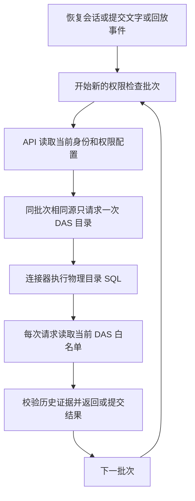

# 目录读取复用调试实测

日期：2026-10-10。用户要求使用已开启的模型调试。主代理单独执行，依赖操作为 0。

## 调试结论

批次内复用已经生效，截图中会话的恢复不再按每份证据重复读取目录。但当前每批权限复核仍触发一次物理目录发现，流式文字提交会产生多批读取。现有实现只保留同一连接器正在进行的发现 Promise；完成即释放。

API/DAS 全量类型检查与标准构建步骤已通过。此前沙箱环境中的隐式 `any` 报告在正常权限下未复现，不能据此认定为既有代码错误。本轮新增 DAS 测试对象缺少必填字段的问题已修正，3 项测试及 lint、格式检查通过。

## 实际历史会话

开始检查时，本机 3101、3102、5173 没有监听服务。测量使用工作区正式 `ConversationService`、`AnalysisRunService`、目录授权服务，以及临时回环端口上的正式 DAS 目录路由、JWT 验签、连接器和 SQL 驱动。认证使用当前配置账号的正常登录流程，结束撤销本次测试登录。

目标是标题匹配“2024”和“危急”的已有会话：7 条消息、5 个运行、7 份查询证据。读取过程未修改该会话。业务元数据仓储限定 SELECT，未运行迁移或重新执行历史业务查询；没有启动完整 API/Web，以下耗时不含页面渲染。

| 操作                         |    第一次 |   第二次 |   第三次 | 每次 DAS 目录请求 |
| ---------------------------- | --------: | -------: | -------: | ----------------: |
| 恢复会话                     | 1125.4 ms | 796.6 ms | 634.5 ms |                 1 |
| 读取同一已完成运行的事件批次 |  698.5 ms | 693.6 ms | 623.6 ms |                 1 |

三次恢复返回内容一致。事件读取每次返回 13 个事件、完成状态。六次操作共执行 6 次物理目录 SQL，没有触发资源上限。

记录：[历史会话读取.json](历史会话读取.json)。这是单次调试采样，不是并发压测或延迟分位数。

## 真实模型

从当前开发库只读取得已启用的 `rj-agent` v1 和 `rj-model-v2` v1，运行现有真实模型对话集成测试。测试在随机命名的隔离 API/DAS 数据库中执行，通过正式 DAS HTTP 和 SQL 查询样本数据，结束清理隔离库及测试模型进程。

测试通过：A 科室权限下只得到 A 科室的 2 个去重就诊人次；重建官方模型进程后恢复同一线程，追问“加 1”得到 3，追问没有执行新的业务 SQL。

| 范围                               |                   耗时 | DAS 目录请求 | 其中由文字 delta 提交触发 |
| ---------------------------------- | ---------------------: | -----------: | ------------------------: |
| 首次模型执行                       |             42512.5 ms |           45 |                        37 |
| 重建进程后的追问执行               |              3909.6 ms |            9 |                         5 |
| 测试读取状态、证据、事件等其余检查 |                      — |            3 |                         0 |
| 合计                               | 测试文件总耗时 54.84 s |           57 |                        42 |

当前测试只显式读取事件，没有连接浏览器持续 SSE。数据源是隔离样本表，也未装配完整生产记忆服务，因此该数量不能当作实际危急值会话每轮的固定次数。它证明文字输出和历史权限复核会继续跨批次读取目录。

记录：[真实模型目录计数.json](真实模型目录计数.json)、[真实模型流式时序.json](真实模型流式时序.json)。流式时序文件记录首轮；目录计数文件记录两轮及测试检查，内部嵌套计时不能相加。

执行入口为现有 `tests/integration/dialogue.integration.ts`，设置 `LOCAL_MODEL_ACCEPTANCE=1`、`LOCAL_MODEL_AGENT_ID=rj-agent`，只选择“本地模型通过普通函数”用例。调试计数通过 `secrets/catalog-debug/observe.ts` 包装正式类方法，未改变生产代码路径。

## 物理目录对照实验

另一个临时诊断进程复用第一次物理目录结果；每次 API 授权和 DAS 白名单仍独立读取。此开关只用于测量，未加入生产连接器，也未实现生产缓存的时效和管理刷新规则。

| 指标                     |    当前正式行为 | 临时物理目录复用对照 |
| ------------------------ | --------------: | -------------------: |
| 六次操作的 DAS HTTP 请求 |               6 |                    6 |
| 六次操作的物理目录 SQL   |               6 |                    1 |
| 首次恢复（各自冷启动）   |       1125.4 ms |            1984.7 ms |
| 后两次恢复               | 634.5～796.6 ms |      167.5～192.6 ms |
| 三次事件读取             | 623.6～698.5 ms |        80.0～98.9 ms |

首读存在连接和 SQL 耗时波动；对照结果说明复用物理目录后，后续权限复核的大部分物理发现成本可以消除，不保证生产环境固定达到表中耗时。DAS HTTP 请求仍存在，重型系统目录 SQL 减少。

记录：[物理目录复用对照.json](物理目录复用对照.json)。临时脚本为 `ai-data/apps/api/secrets/catalog-debug/live-read-profile.ts`，仅对照运行设置 `CATALOG_PROFILE_REUSE_PHYSICAL=1`。

## 当前流程

## 用户确认的后续范围

2026-10-10，用户明确取消 DAS 30 秒物理目录缓存方案，认为该职责不应由 DAS 承担。该方案未加入产品代码。当前 DAS 只合并正在执行的目录发现请求；完成后释放结果。后续工作转为说明 API 私有图片附件的存储、读取与清理机制。

## 本轮文件和环境变更

产品逻辑未在这次调试中继续调整。补齐 DAS 新增测试夹具字段，修正目录交付说明中的构建结论，新增本目录测量文件，并追加 README 接手入口。API/DAS `dist/index.js` 已按标准构建步骤更新；现有完整服务未手动启动或重启，`release` 未重新封包。
